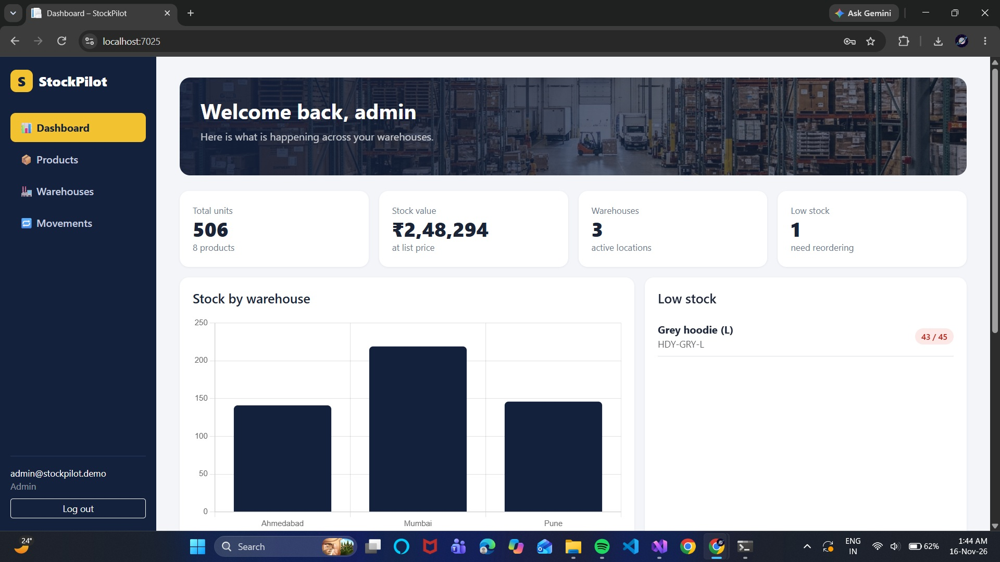
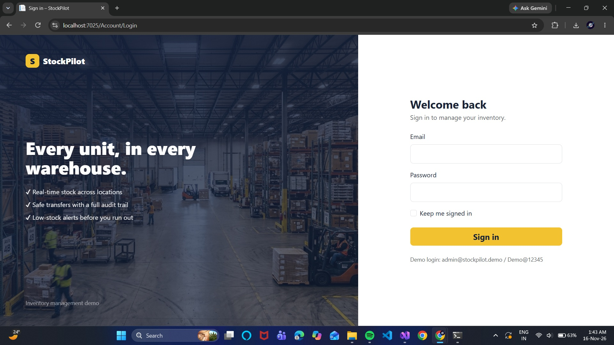
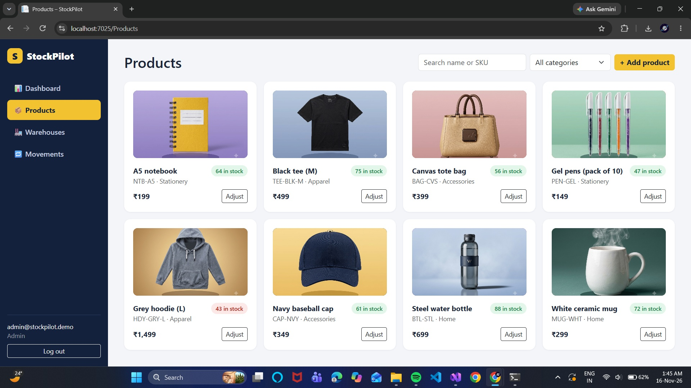
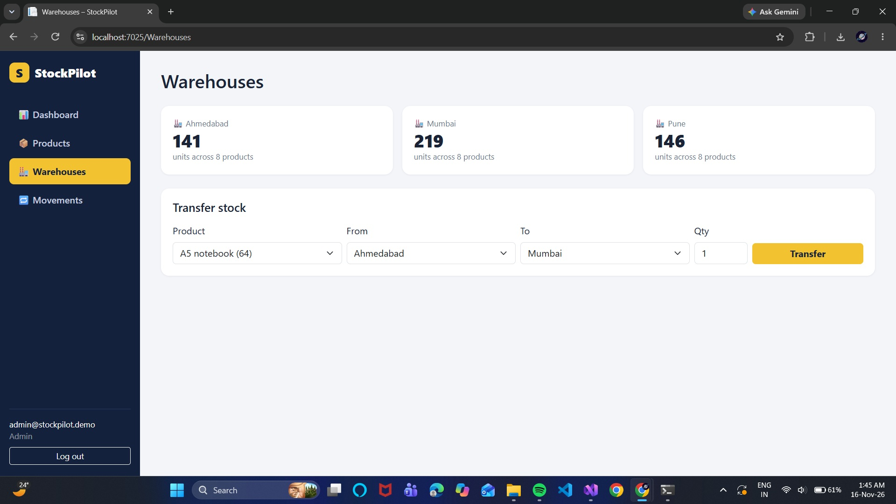
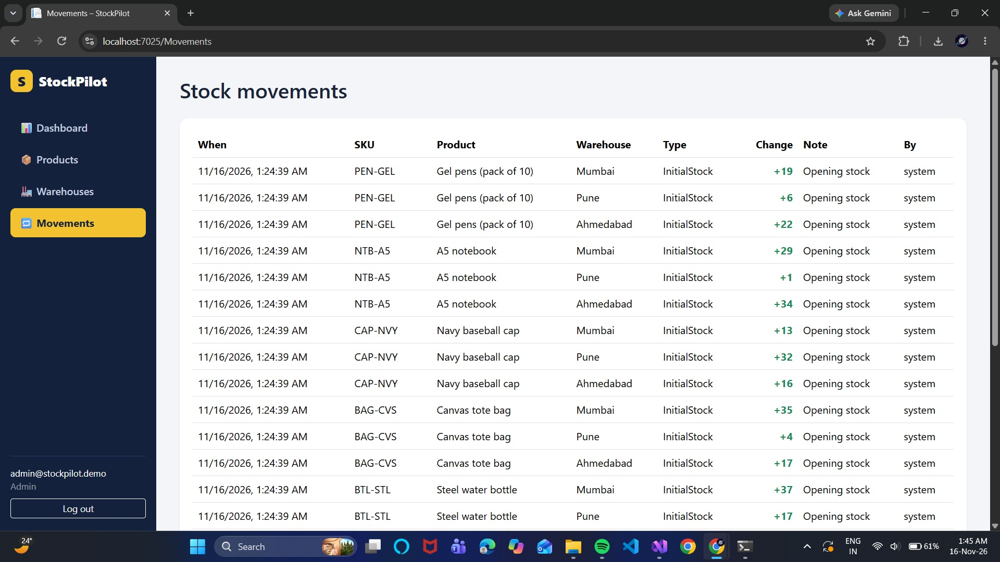

# StockPilot

A multi-warehouse inventory management app built with ASP.NET Core MVC, EF Core and SQL Server. It tracks stock across locations, moves units between warehouses safely, keeps a full audit trail of every change, and shows live stock insights on a dashboard.

## Features
- **Login and roles:** ASP.NET Core Identity with cookie authentication, lockout on repeated failures, and Admin and Warehouse roles
- **Dashboard:** KPI cards (units, stock value, warehouses, low stock), stock-by-warehouse chart, low-stock list and recent activity
- **Products:** search, category filter, product images, stock adjustments, and admin-only create, update and delete
- **Warehouses:** per-location totals and stock transfers between locations
- **Atomic transfers:** both warehouses and both history entries save together, or nothing changes
- **Audit trail:** every adjustment and transfer is recorded with who, when, why and how much
- **Data integrity:** foreign keys, unique SKUs, validation, and protection against deleting items that have history
- **REST API** documented with Swagger, plus unit tests for the core business rules

## Screenshots
| Login | Products |
|---|---|
|  |  |

| Warehouses | Movements |
|---|---|
|  |  |

## Tech stack
C#, .NET 10, ASP.NET Core MVC, Web API, Entity Framework Core (migrations), SQL Server (LocalDB), ASP.NET Core Identity, xUnit, Swagger, HTML, CSS, JavaScript (Fetch API), Bootstrap, Chart.js, Git

## API overview
| Method | Endpoint | Description | Access |
|---|---|---|---|
| GET | `/api/products` | List products (search, category, paging) | Signed in |
| GET | `/api/products/{id}` | Product with stock per warehouse | Signed in |
| POST / PUT / DELETE | `/api/products` | Create, update, delete products | Admin |
| GET | `/api/warehouses` | Warehouses with totals | Signed in |
| POST / PUT / DELETE | `/api/warehouses` | Manage warehouses | Admin |
| POST | `/api/stock/adjust` | Add or remove stock with a note | Signed in |
| POST | `/api/stock/transfer` | Move stock between warehouses | Signed in |
| GET | `/api/stock/movements` | Audit trail of stock changes | Signed in |
| GET | `/api/stock/low` | Items below their reorder level | Signed in |
| GET | `/api/dashboard/stats` | Dashboard figures | Signed in |

Responses use clear status codes: 400 for invalid input or insufficient stock, 404 for a missing product or warehouse, 409 for a duplicate SKU, 401 when not signed in.

## Run it locally
1. Install the .NET 10 SDK and Visual Studio with the **ASP.NET and web development** workload (includes LocalDB).
2. Clone the repo and open `StockPilot.sln`.
3. Press **F5**. The database, migrations, demo user and sample data are created on first run.
4. Sign in with the demo account: `admin@stockpilot.demo` / `Demo@12345`
5. Open `/swagger` in the same browser session to try the API.

The demo account is for local development only.

## Run the tests
Open **Test Explorer** in Visual Studio and choose **Run All Tests**, or run `dotnet test` in the solution folder.

## Design decisions
- **Stock lives in its own table**, because one product can sit in many warehouses.
- **Business rules are in `StockService`**, separate from the controllers, so they can be unit tested without HTTP.
- **Transfers use a single `SaveChanges` call**, so a failed transfer never leaves partial changes.
- **Movements are never deleted**: foreign keys block removing a product or warehouse that has history.
- **Every controller requires sign-in by default**, and anonymous access is opt-in.

## Roadmap
- Purchase orders and sales orders
- Reorder suggestions from sales velocity
- Concurrency protection for simultaneous updates
- GitHub Actions CI and Azure deployment
- AI assistant for natural-language stock questions
